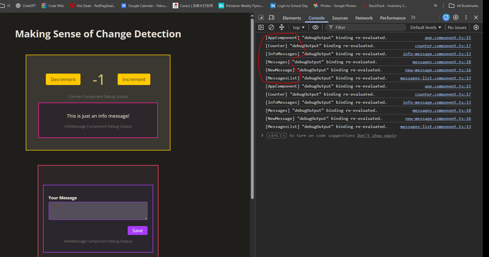
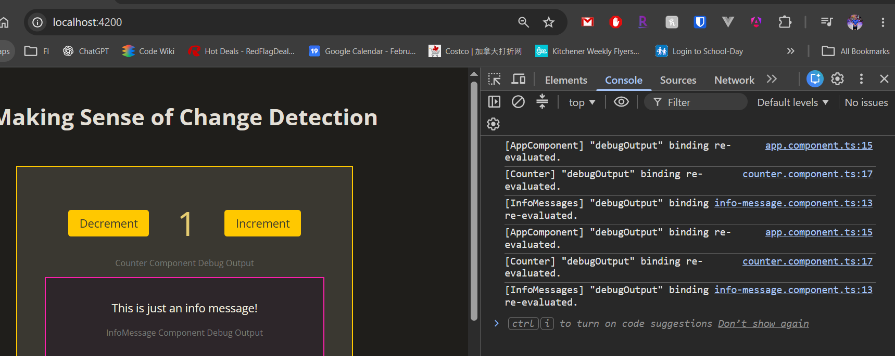

ctrl+shift+v to view picture

AppComponent
├── CounterComponent <- click here, every component will be re-evluated
│ └── InfoMessageComponent
└── MessagesComponent

with the default strategy, Angular checks template bindings across the component tree when change detection runs, even if the event happened in just one component.

{{ count() }}

{{ debugOutput }}

if a template expression performs expensive work, repeatedly evaluating it can make change detection slow, even when the result hasn’t changed

also, same log print twice!
This is expected in Angular development mode. Angular performs two passes:

1. Normal check: evaluates bindings and updates the DOM where needed.
2. Verification check: evaluates bindings again to ensure their values stayed consistent.

AppComponent
├── CounterComponent <- click here, every component will be re-evluated
│ └── InfoMessageComponent
└── MessagesComponent (OnPush)

